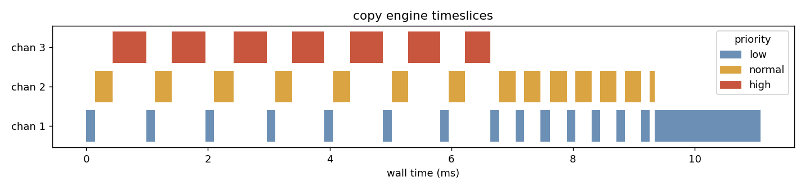

# vgpu — a virtual GPU driver stack

A Linux kernel module that implements a GPU-style **resource manager** (VRAM
allocator, per-process GPU address spaces, command channels, doorbells,
semaphores, a timeslice scheduler, fault handling) for a simulated device,
plus a C++ user-mode runtime on top of it. Built to exercise the same concepts
a GPU/Tegra system-software team works with: driver stacks, resource
management, memory management, scheduling, and the user/kernel boundary.

```
 app ─▶ libvrm (C++) ─▶ ioctl / mmap ─▶ vgpu.ko ─▶ OS-agnostic RM core ─▶ virtual engines
                  └──────── in-process simulator (same core) ────────┘
```

The resource-manager core in `core/` is plain C with no OS dependencies. It is
compiled into the kernel module **and** into a user-space simulator, so the
identical test suite runs against both. See [docs/ARCHITECTURE.md](docs/ARCHITECTURE.md).

## What's in it

| Area | Where | Highlights |
| --- | --- | --- |
| Memory management | `core/vrm_mem.c` | bitmap page allocator, 2-level GPU page tables, guard pages, scrub-on-alloc, pinned mappings |
| Channels + executor | `core/vrm_exec.c` | lock-free ring submission (acquire/release get/put), 7-op command set, semaphores, fault containment |
| Scheduler | `core/vrm_exec.c` | per-engine round-robin, priority-scaled timeslices in virtual time (deterministic) |
| Kernel driver | `kmod/vgpu_main.c` | misc device, ioctl ABI, `mmap` of vmalloc'd VRAM, per-engine kthreads, `/proc/vgpu` |
| User runtime | `user/` | RAII `Device` / `Buffer` / `Channel`, backend interface, in-process simulator |
| Tests | `tests/vgpu_tests.cpp` | 20 tests: allocator, isolation, faults, dependencies, fairness, multithreaded stress |
| Tooling | `tools/` | `vgpu_bench` (latency, bandwidth, fairness), `vgpu_trace`, `plot_trace.py` Gantt |

## Build and run (WSL2 Ubuntu)

One-time setup (installs packages, fetches and prepares the WSL kernel tree;
the first run builds `vmlinux` to get `Module.symvers`, so it takes a while):

```bash
sudo bash scripts/wsl-setup.sh
```

User-space build + tests on the simulator (also runs under sanitizers):

```bash
bash scripts/wsl-build.sh test          # build + run tests (sim backend)
bash scripts/wsl-build.sh asan          # ASan + UBSan
bash scripts/wsl-build.sh tsan          # ThreadSanitizer
```

Kernel module:

```bash
bash scripts/wsl-build.sh kmod
bash scripts/wsl-build.sh user
sudo bash scripts/demo.sh               # insmod, kernel-backend tests, benchmarks, /proc, rmmod
```

`scripts/wsl-build.sh` copies the tree from the Windows drive to the WSL
filesystem first (fast, and kernel builds dislike drvfs).

## Results (WSL2, kernel 6.6.87.2, 12 vCPUs)

* All 20 tests pass on both backends. The simulator build is also clean under
  ASan+UBSan and TSan. Load/test/unload cycles leave no VRAM leaks and nothing
  in `dmesg`.
* The scheduler is deterministic: kernel and simulator produce **identical**
  fairness numbers. Three clients with equal work and LOW/NORMAL/HIGH priority
  get 12.9% / 30.0% / 57.1% of the copy engine while all three are
  competing; the 1 : 2 : 4 timeslice ratio predicts 14.3 / 28.6 / 57.1.
* Submit → fence round trip through ioctl doorbell and kthread wakeup:
  p50 6 µs, p99 34 µs.



## Usage sketch

```cpp
vrm::Device dev = vrm::Device::open_kernel();            // or vrm::open_sim(gpu)
vrm::Buffer src = dev.alloc(1 << 20), dst = dev.alloc(1 << 20), sem = dev.alloc(4096);
vrm::Channel ch = dev.channel(VGPU_ENGINE_COPY, VGPU_PRIO_HIGH);

ch.memcpy(dst.va(), src.va(), 1 << 20)
  .fence(sem.va(), 1)
  .submit();                                              // release-store put + doorbell
dev.wait_sem(sem.va(), 1);                                // sleeps in the kernel until the fence lands
```
